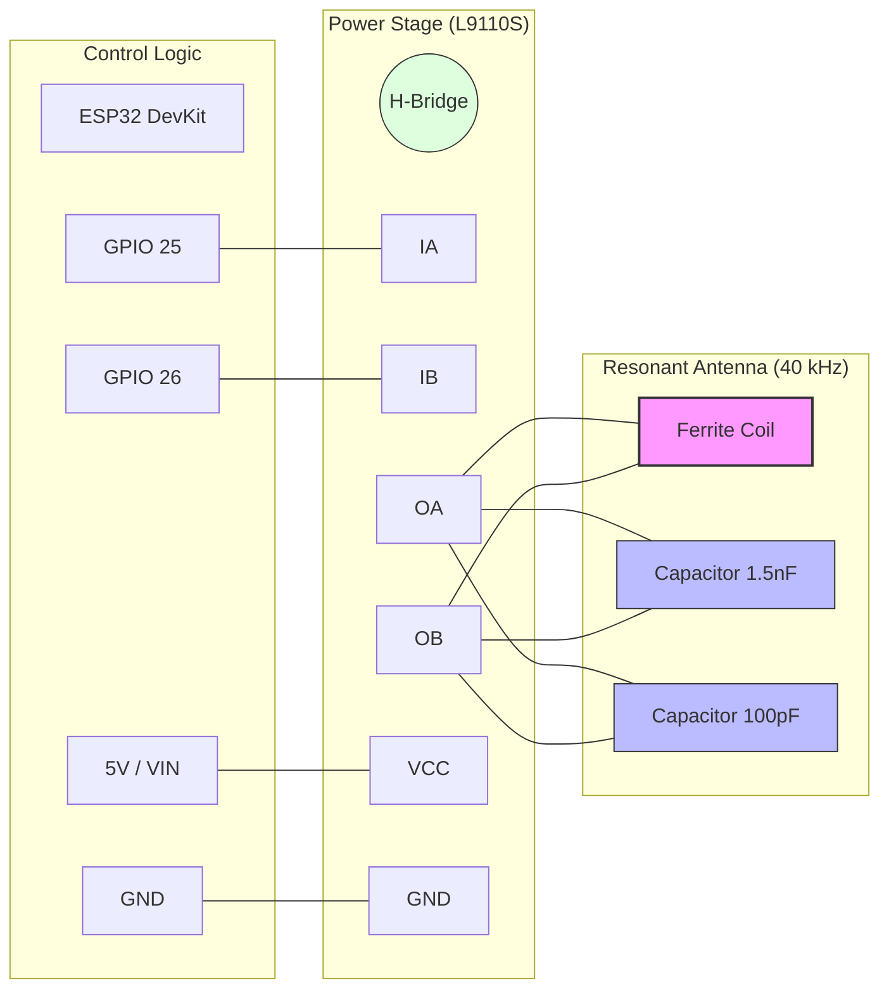

# JJY 40 kHz Simulator for ESP32

This project is a high-performance JJY (Fukushima 40 kHz) time signal simulator designed for ESP32 and the L9110S motor driver. It allows you to synchronize radio-controlled clocks (like those from Casio, Citizen, etc.) by simulating the Japanese JJY time signal.

Detailed project documentation and build log can be found here: [JJY Signal Simulator with ESP32 — 5m Range DIY Build](https://olafkrawczyk.com/journal/jjy-signal-simulator/)

## Motivation

Radio-controlled clocks designed for the Japanese market are often hardwired to listen only for the JJY longwave signal. Outside of Japan, these clocks cannot sync and must be set manually. This project "brings the signal to the clock" by creating a local transmitter that broadcasts the JJY protocol, allowing these "self-correcting" devices to function as intended anywhere in the world.

## Parts List

| Component | Specification / Detail |
| :--- | :--- |
| **Microcontroller** | ESP32 DevKitV1 (ESP-WROOM-32) |
| **Power Amplifier** | L9110S dual-channel motor driver |
| **Ferrite Core** | 2× 50mm NiZn ferrite rods (bonded to 100mm) |
| **Coil Wire** | ~11m enameled copper wire (~250–300 turns) |
| **Resonant Capacitor 1** | ~1.5 nF MKP film capacitor (Primary resonance) |
| **Resonant Capacitor 2** | ~100 pF ceramic disc capacitor (Fine-tuning/Trimming) |
| **Power** | Micro-USB cable + 5V supply |

## Hardware Setup

The project uses an "Antiphase drive" concept to increase the voltage swing across the transmission tank circuit.

- **MCU:** ESP32
- **Driver:** L9110S (or similar H-bridge)
- **Connections:**
  - `PIN_IA` (GPIO 25) -> L9110S IA
  - `PIN_IB` (GPIO 26) -> L9110S IB
  - `PIN_TX_LED` (GPIO 2/Built-in) -> Transmission status LED

### Wiring Diagram

#### Physical Layout (ASCII)
```text
      ESP32 DevKit                L9110S Driver
    +--------------+            +--------------+
    |   [USB]      |            |              |
    |          VIN |------------| VCC (5V)     |
    |          GND |------------| GND          |
    |      GPIO 25 |------------| IA           |
    |      GPIO 26 |------------| IB           |
    +--------------+            |              |
                                |   OA    OB   |
                                +---|-----|----+
                                    |     |
            +-----------------------+     |
            |                             |
            |     +-------+-------+       |
            +-----|  COIL |  C1   |  C2   |
            |     | (Ant) | 1.5nF | 100pF |
            +-----|       |       |       |
            |     +-------+-------+       |
            |       (Parallel Tank)       |
            +-----------------------------+
```

#### Schematic Flow (Mermaid)


### Simplified Pin Mapping

| ESP32 Pin | L9110S Pin | Notes |
| :--- | :--- | :--- |
| GPIO 25 | IA | PWM Signal A |
| GPIO 26 | IB | PWM Signal B (Inverted) |
| GND | GND | Common Ground |
| VIN (5V) | VCC | Driver Power |
| - | OA | Antenna Out A |
| - | OB | Antenna Out B |

## Setting it up (no computer needed)

1. Plug the transmitter into a USB charger.
2. On your phone, join the WiFi network **JJY-Setup-XXXX**. A setup page opens by itself. If it doesn't, open any website and you'll be sent there.
3. Pick your home WiFi and type its password.
4. Pick the city you live in. Your clock will show that city's time.
5. Keep the suggested broadcast times unless you know when your clock checks the time, then press **Connect**.

When it says **Done!**, rejoin your home WiFi. You can change settings at **http://jjy.local**. If that address doesn't open (some Android phones can't use it), use the IP address shown on the **Done!** screen.

The transmitter sleeps between broadcasts. To open the settings page, unplug it and plug it back in: it stays awake for 10 minutes.

## Changing WiFi

- **From the settings page:** press **Forget WiFi**.
- **If it can't reach your WiFi any more** (new router or password): unplug it and plug it back in **three times in a row, quickly** (each time within 10 seconds). The JJY-Setup network comes back. Your time zone and schedule are kept.

## Updating

On the settings page, press **Check for updates**, then **Install**. Don't unplug it while it updates (about a minute). If an update fails, the previous version keeps running.

## Features

- **Antiphase drive:** 40 kHz carrier on two pins in opposite phase, with dead time and a 5 ms soft ramp.
- **Phone setup:** open setup hotspot with a captive portal, so no app is needed.
- **Schedule:** up to 8 daily broadcast times with a shared length; deep sleep in between.
- **Time zones:** city list that preselects the phone's zone, plus custom POSIX rules.
- **Updates:** one-tap install from GitHub releases, with automatic rollback if a new version fails to start.

## Development

- Firmware: `pio run -e esp32doit-devkit-v1 -t upload`
- Unit tests (Linux/macOS/WSL): `pio test -e native`
- Serial commands at 115200 baud: `+` / `-` change the carrier by 10 Hz, `?` prints it.

## Releasing

Push a tag such as `v1.2.0`. GitHub Actions runs the tests, builds the firmware with that version number and publishes a release with `firmware.bin` attached. Devices see it under **Check for updates**.

If GitHub changes its certificate authorities, regenerate `src/certs.h` with `tools/make_certs_header.sh` on a Linux machine.

## License

This project is licensed under the MIT License - see the [LICENSE](LICENSE) file for details.
