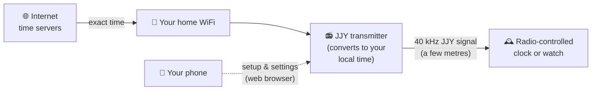
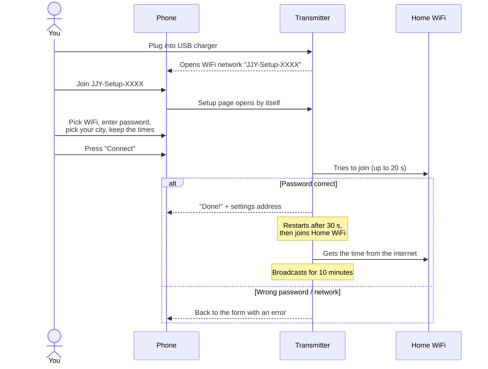
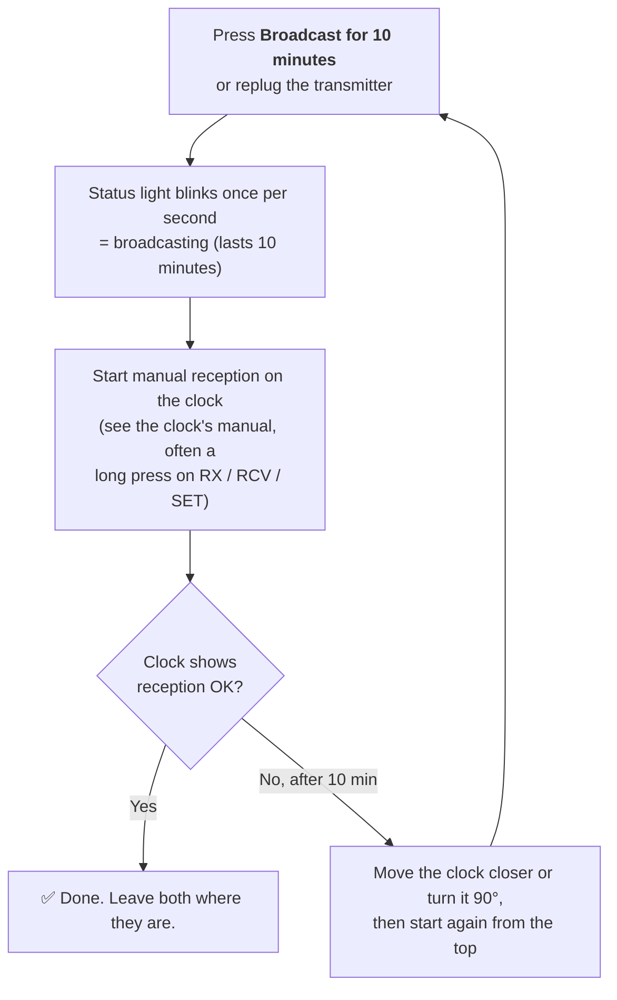
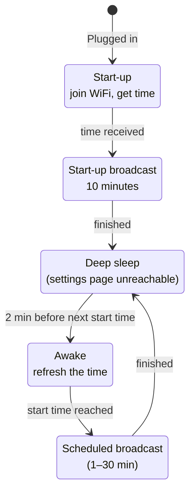
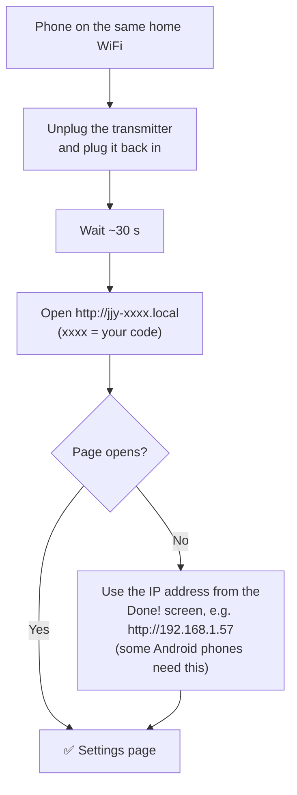
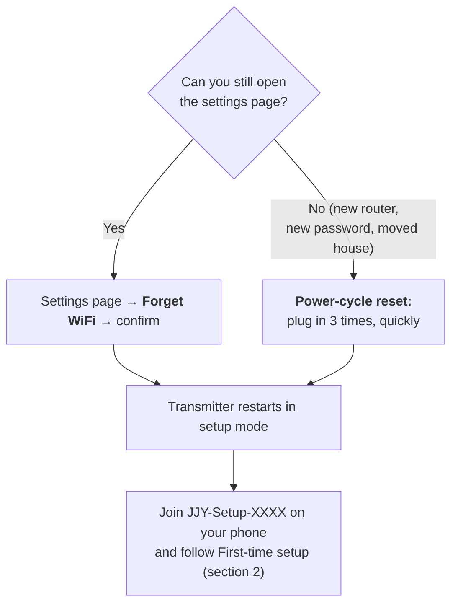
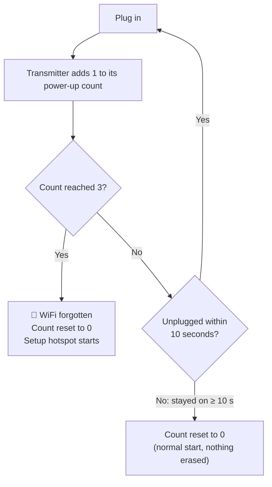
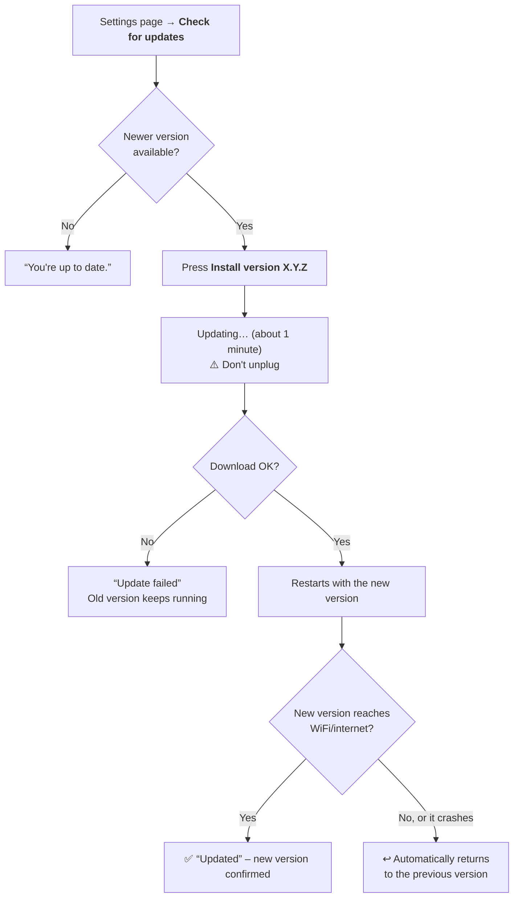
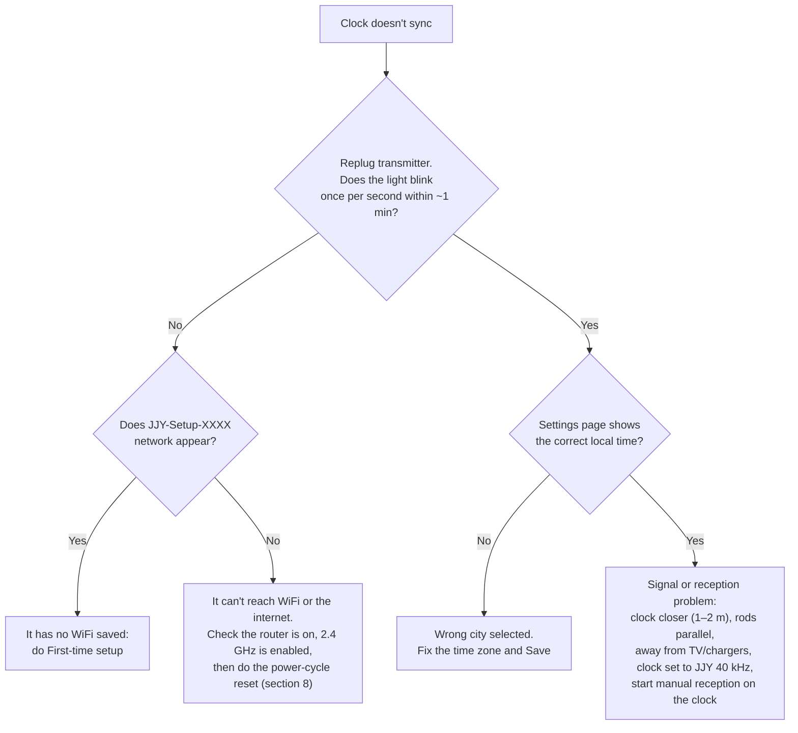

# JJY Clock Transmitter: User Manual

This small box broadcasts the Japanese **JJY 40 kHz** time signal in your home, so a radio-controlled clock or watch made for Japan can set itself anywhere in the world. It gets the correct time from the internet over your WiFi and sends it to your clock.

You don't need an app or a computer. Setup and settings both happen in your phone's web browser.

---

## Contents

1. [How it works](#1-how-it-works)
2. [First-time setup](#2-first-time-setup)
3. [Where to put the transmitter](#3-where-to-put-the-transmitter)
4. [Syncing your clock](#4-syncing-your-clock)
5. [The daily routine: broadcasting and sleeping](#5-the-daily-routine-broadcasting-and-sleeping)
6. [The status light](#6-the-status-light)
7. [The settings page](#7-the-settings-page)
8. [Changing WiFi and the reset procedure](#8-changing-wifi-and-the-reset-procedure)
9. [Software updates](#9-software-updates)
10. [Using several transmitters](#10-using-several-transmitters)
11. [Troubleshooting](#11-troubleshooting)
12. [Technical reference](#12-technical-reference)

---

## 1. How it works



- The transmitter gets the exact time from the internet.
- It converts that time to the time zone you chose, so the clock shows **your local time**, not Japanese time.
- At set times each day it broadcasts for a few minutes. Your clock usually listens for the signal at night.
- Between broadcasts it sleeps to save power and keep the radio quiet.

---

## 2. First-time setup

You need a USB phone charger, a micro-USB cable, your phone and your home WiFi password.



### Step by step

1. **Plug in** the transmitter.
2. On your phone, open the WiFi settings and join **JJY-Setup-XXXX**. `XXXX` is a four-character code unique to your transmitter, for example `JJY-Setup-A41C`. This network has no password.
3. **The setup page opens by itself.** If it doesn't, open your browser and go to any website. You'll be sent to the setup page.
4. Fill in the three sections:

   | Section | What to do |
   | :--- | :--- |
   | **1. WiFi** | Pick your home network from the list and type its password. If it's missing, tap *Refresh the list*, or choose *Other network…* and type the name. |
   | **2. Where are you?** | Pick your city. It's usually already selected from your phone's time zone. **Your clock will show this city's time.** |
   | **3. When does your clock check the time?** | Keep the suggested times unless you know your clock's schedule (see [section 5](#5-the-daily-routine-broadcasting-and-sleeping)). |

5. Press **Connect** and keep the page open for up to 20 seconds.
6. When the screen says **Done!**, **write down the address it shows**, for example `http://jjy-a41c.local` and an IP address such as `http://192.168.1.57`. You'll use it to change settings later.
7. Switch your phone back to your home WiFi. The setup network turns itself off.

> **Note:** The transmitter only works with **2.4 GHz** WiFi, which is what almost all home routers offer. WiFi passwords must be 8 to 63 characters long, or empty for an open network.

---

## 3. Where to put the transmitter

The signal is deliberately weak. It reaches **a few metres** (about 5 m in good conditions), so it can't disturb your neighbours.

```text
      Good                                   Poor
  ┌───────────────┐                    ┌───────────────┐
  │  [TX]══════   │  ← rod antennas →  │  [TX]══════   │
  │               │     parallel       │               │
  │  [CLOCK]═══   │                    │  [CLOCK]  ║   │  ← antenna at
  └───────────────┘                    └───────────║───┘    right angle
      1–3 m apart                         > 5 m, behind
      no metal between                    metal / near TV
```

Placement tips:

- **Closer is better.** For the first sync, put the clock within 1–2 m of the transmitter.
- **Line up the antennas.** The transmitter has a long ferrite rod. Clocks have a similar rod inside, usually running along the long side of the case. The signal is strongest when the two rods are **parallel**. If reception fails, try turning the clock by 90°.
- **Avoid noise sources** such as TVs, monitors, LED dimmers, phone chargers and metal shelves near the clock.
- **Keep the transmitter near your WiFi.** It needs WiFi at power-up and before each broadcast to get the exact time.

---

## 4. Syncing your clock

Most radio clocks check the time on their own a few times each night. To sync **right now**, start a 10-minute broadcast in either of two ways:

- **From the settings page:** press **Broadcast for 10 minutes**. Pressing it again during a broadcast extends it to 10 minutes from that moment.
- **Without a phone:** unplug the transmitter and plug it back in. It broadcasts for 10 minutes once it has the time, about 30 s after power-up.



**Is 10 minutes enough?** Usually, yes. The time signal repeats every minute, and a clock needs a few clean minutes in a row. Most clocks sync in 2–10 minutes when they are close to the transmitter. If reception is weak, a clock may need longer. Press the button again to keep the broadcast going.

> **Tip:** Make sure the clock is set to receive **JJY 40 kHz** (sometimes labelled *Fukushima* or *JJY40*). Clocks that also support other stations (WWVB, DCF77, MSF) may need a setting or region change. Check your clock's manual.

---

## 5. The daily routine: broadcasting and sleeping

The transmitter isn't on all the time. It wakes up, broadcasts for a few minutes at each start time, and sleeps in between.

### Default schedule

The default is **seven broadcasts a day, 5 minutes each**: at **01:16, 02:00, 03:16, 04:00, 13:16, 15:16 and 16:16** local time. These cover the times most Japanese radio clocks listen.

```text
 00    02    04    06    08    10    12    14    16    18    20    22    24
 |-----|-----|-----|-----|-----|-----|-----|-----|-----|-----|-----|-----|
    █  █  █  █                             █     █  █
    │  │  │  └ 04:00                       │     │  └ 16:16
    │  │  └ 03:16                          │     └ 15:16
    │  └ 02:00                             └ 13:16
    └ 01:16
 █ = 5-minute broadcast          (sleeping the rest of the time)
```

You can set **1 to 8 start times** and a **broadcast length of 1 to 30 minutes**. Broadcasts must not overlap.

### What happens during the day



Things to know:

- **Every time it's plugged in**, it broadcasts for **10 minutes** once it has the time. This is the easiest way to force a sync.
- **While asleep, the settings page can't be reached.** To open it, unplug and replug the transmitter (see [section 7](#7-the-settings-page)).
- If WiFi is down when it wakes up, it uses the time it kept while sleeping, which is accurate enough for a few days.
- If the transmitter has **never** got the time since being plugged in (for example, WiFi is down), it **doesn't broadcast**. It won't send a wrong time.
- Summer/winter time changes are handled automatically for the city you chose.

---

## 6. The status light

The small blue light on the board shows the radio signal.

| Light | Meaning |
| :--- | :--- |
| **Off** | Sleeping, waiting for the next broadcast, setup mode, or no time from the internet yet. |
| **Blinks once per second** | Broadcasting. Each second it lights for 0.2 s, 0.5 s or 0.8 s, which is the time code itself. |

```text
 Broadcasting (one second per box):
 ┌────────┬────────┬────────┬────────┐
 │██      │█████   │████████│██      │   ██ 0.2 s = marker
 └────────┴────────┴────────┴────────┘   █████ 0.5 s = "1"
                                          ████████ 0.8 s = "0"
```

---

## 7. The settings page

### Opening it



After a replug the page stays available **for at least 10 minutes**. While the page is open the transmitter stays awake until you press **Save**, or for up to 15 minutes after you last used the page. The page can also be reached during scheduled broadcasts and in the 2 minutes before each one.

> **Can't find the IP address?** Look for a device called `jjy-xxxx` in your router's list of connected devices.

### What's on the page

| Section | What it does |
| :--- | :--- |
| **Clock and status** | The transmitter's current local time, and *Broadcasting until HH:MM* or *Next broadcast at HH:MM*. If the time is wrong here, your clock will be wrong too: check the time zone. |
| **Broadcast for 10 minutes** | Starts broadcasting right away so you can sync a clock now (see [section 4](#4-syncing-your-clock)). Saving settings doesn't cut this broadcast short. |
| **Where are you?** | Your time zone. Each city shows its standard (winter) offset, for example *(GMT+1) Warsaw*. After you pick a new city, a reminder appears: the change only takes effect when you press **Save**. *Custom rule (advanced)* accepts a POSIX TZ rule for places not in the list. |
| **When does your clock check the time?** | Start times (up to 8; use **Add a time** and **✕** to add and remove) and broadcast length in minutes. |
| **Save** | Stores the settings. If you changed the time zone or schedule during a scheduled broadcast, that broadcast stops and the next one uses the new settings. |
| **Device** | Address, software version, **Check for updates**, and **Forget WiFi**. |

After **Save**, the page shows the next broadcast time. A few seconds later the transmitter may go to sleep, so the page stops responding. This is normal.

---

## 8. Changing WiFi and the reset procedure

There are two ways to connect the transmitter to a different WiFi network. **Both keep your time zone and schedule.** Only the WiFi name and password are erased.



### Option A: from the settings page

1. Open the settings page (section 7).
2. Under **Device**, press **Forget WiFi** and confirm.
3. After about 3 seconds the transmitter restarts and the **JJY-Setup-XXXX** network appears.

### Option B: the power-cycle reset (no phone needed)

Use this when the transmitter can't reach your WiFi any more. **Plug it in three times in a row, unplugging each time before 10 seconds have passed.**

```text
 Power  ON ███        ███        ███████████████████████████▶
       OFF    ░░░░░░░░   ░░░░░░░░
            │◀─3 s─▶│  │◀─3 s─▶│  │
            plug-in #1  plug-in #2  plug-in #3
            (count 1)   (count 2)   (count 3 → WiFi forgotten,
                                     JJY-Setup-XXXX appears)

 Each ON period must be shorter than 10 seconds.
 OFF periods can be any length.
```



**Recommended rhythm:** plug in, count to three, unplug, count to three. Repeat. On the third plug-in, leave it plugged in.

Good to know:

- Only **real power-ups** count, meaning pulling and reinserting the USB cable or switching the charger off and on. Waking from sleep doesn't count.
- If you wait too long during any step, the count starts over. Just begin again.
- One or two short power cuts won't erase anything. It takes three in a row.
- Unplug **before** 10 seconds, but give each plug-in about 2–3 seconds so the transmitter has time to register it.

---

## 9. Software updates



- Updates come from the project's GitHub releases. The transmitter needs internet access to check and install.
- If the page says **This is taking too long** after 3 minutes, unplug the transmitter, plug it back in and open the settings page again. Thanks to the automatic rollback, it'll run either the new version or the old one.
- Your settings are kept across updates.

---

## 10. Using several transmitters

You can have several transmitters on the same WiFi, for example one per room. Each has its own code and address:

| Transmitter | Setup network | Settings address |
| :--- | :--- | :--- |
| Living room | `JJY-Setup-A41C` | `http://jjy-a41c.local` |
| Bedroom | `JJY-Setup-07F2` | `http://jjy-07f2.local` |

If two transmitters are **within a few metres** of each other, give them **different start times** (for example 01:16 and 01:26). Two signals on the same frequency at the same time interfere and neither clock may sync.

---

## 11. Troubleshooting



| Problem | What to do |
| :--- | :--- |
| Setup page doesn't open after joining JJY-Setup | Open a browser and go to any `http://` website, such as `http://example.com`. If the phone complains the network has no internet, choose to **stay connected**. |
| *Couldn't connect. Check the network name and password* | Re-type the password (it's case-sensitive). Make sure the network is 2.4 GHz. Move the transmitter closer to the router. |
| *Connected, but the settings couldn't be saved* | Press **Connect** again. If it keeps happening, unplug, plug back in and repeat setup. |
| My WiFi isn't in the list | Tap **Refresh the list**, or choose **Other network…** and type its exact name. Hidden and 5 GHz-only networks don't appear. |
| `http://jjy-xxxx.local` doesn't open | Make sure the phone is on the home WiFi, not mobile data. Replug the transmitter first (it may be asleep). Use the IP address instead, which works on all Android phones. |
| The settings page stopped responding | The transmitter went to sleep. Replug it and reload the page. |
| Clock shows the wrong hour | Wrong time zone. Pick the city you're in, not Tokyo (unless you're in Japan), and **Save**. |
| *Broadcasts would overlap…* | Start times are closer together than the broadcast length. Space them out or shorten the broadcast. |
| *Waiting for the time from the internet…* | The transmitter is on WiFi but hasn't got the time yet. Wait a minute. If it stays like this, check that your network allows internet access. It won't broadcast until it has the time. |
| *No updates have been published yet* / *Couldn't check for updates* | Nothing to do now. Try again later. |
| *Update failed* | The previous version is still running. Try again later. |

---

## 12. Technical reference

| Item | Value |
| :--- | :--- |
| Signal | JJY (Fukushima), 40 kHz carrier, amplitude-keyed: 0.2 s marker / 0.5 s "1" / 0.8 s "0" each second |
| Range | A few metres (about 5 m in good conditions) |
| Time source | Internet time servers (`pool.ntp.org`, `time.google.com`) over WiFi |
| WiFi | 2.4 GHz, WPA/WPA2 personal or open; SSID up to 32 characters, password 8–63 characters |
| Setup network | `JJY-Setup-XXXX`, open, with captive portal |
| Settings address | `http://jjy-xxxx.local` or the device IP address |
| Power | 5 V USB (micro-USB) |
| Default time zone | Selected from your phone during setup |
| Default schedule | 01:16, 02:00, 03:16, 04:00, 13:16, 15:16, 16:16; 5 minutes each |
| Schedule limits | 1–8 start times; 1–30 minutes per broadcast; no overlaps |
| Start-up broadcast | 10 minutes after each power-up (once the time is known) |
| Manual broadcast | 10 minutes, from the **Broadcast for 10 minutes** button on the settings page |
| Wake-up before broadcast | 2 minutes |
| WiFi reset | 3 power-ups in a row, each shorter than 10 s |
| Updates | From GitHub releases; automatic rollback if the new version can't reach the network |
| Kept across WiFi reset and updates | Time zone, schedule |

For wiring, parts list and building from source, see the [README](../README.md).
